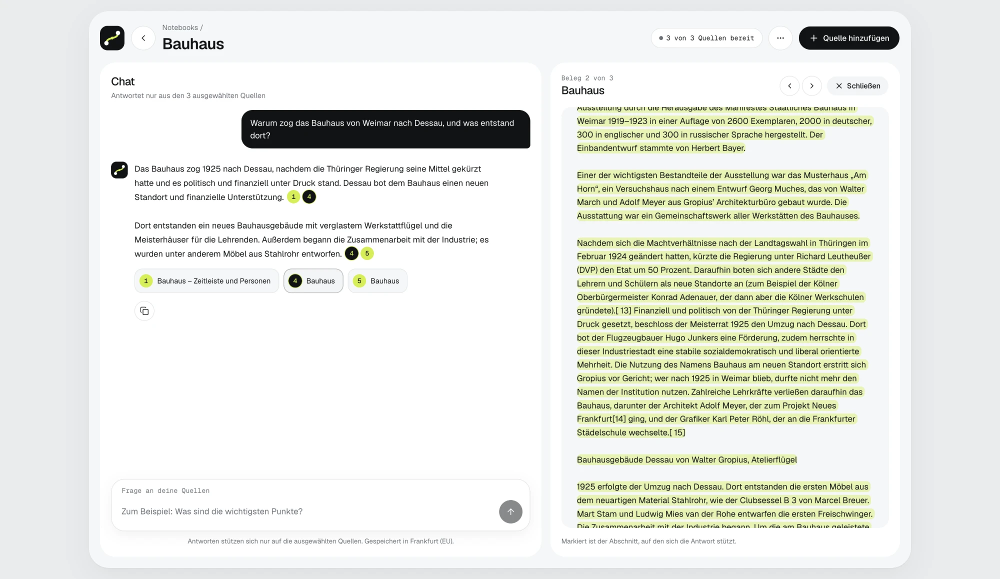
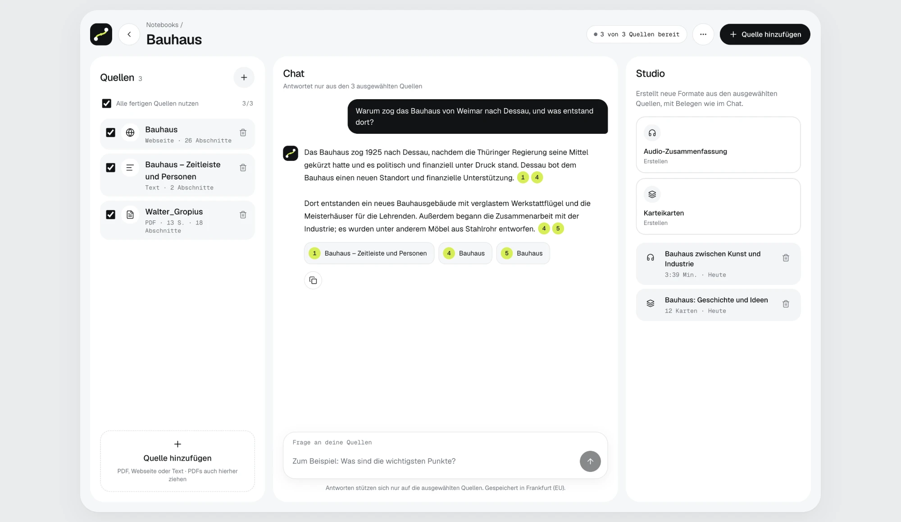
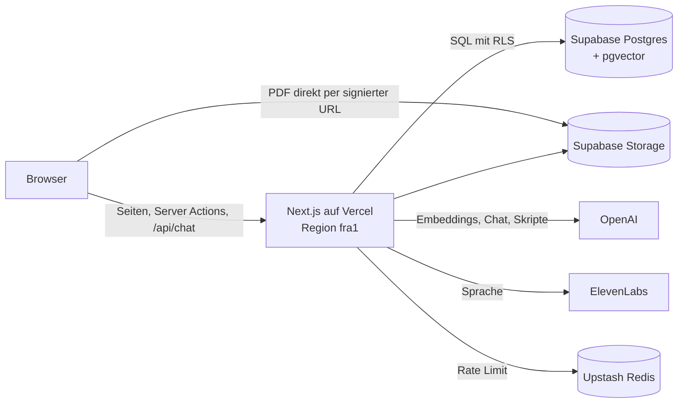

# Faden

Faden ist eine Web-App nach dem Vorbild von NotebookLM. Du lädst Quellen hoch (PDF, Webseite, Text) und stellst Fragen.
Faden antwortet **nur aus diesen Quellen**. Jede Aussage hat einen Beleg wie `[1]`. Ein Klick auf den Beleg zeigt die markierte Stelle in der Quelle.

**Live:** <https://faden-one.vercel.app> · Demo-Zugang mit fertigem Notebook „Bauhaus“ auf Anfrage (es gibt keine offene Registrierung).



## Was Faden kann

- **Notebooks** anlegen, umbenennen und löschen. Ein Notebook sammelt die Quellen zu einem Thema.
- **Quellen:** PDF (bis 20 MB, auch mehrere per Drag & Drop), Webseite per Link, eingefügter Text (bis 200.000 Zeichen). Der Status jeder Quelle ist sichtbar: wartet → in Arbeit → bereit oder Fehler.
- **Gescannte PDFs** ohne Text erkennt Faden und zeigt einen klaren Fehler. Der Ausweg: den Text von Hand einfügen.
- **Chat** mit gestreamter Antwort. Er nutzt nur die ausgewählten Quellen.
- **Belege** `[1]`, `[2]` sind klickbar. Die Beleg-Ansicht zeigt den Text der Quelle mit der markierten Stelle, bei PDFs auf der richtigen Seite.
- **Ehrliche Ablehnung:** Steht die Antwort nicht in den Quellen, sagt Faden: „Dazu habe ich in deinen Quellen nichts gefunden.“
- **Löschen einer Quelle** entfernt die Datei, alle Abschnitte und alle Embeddings.
- **Audio-Zusammenfassung:** ein Podcast mit zwei Stimmen (Lea und Tom). Mit Transkript zum Mitlesen, Belegen und MP3-Download.
- **Karteikarten:** 12 Lernkarten aus den Quellen, ebenfalls mit Belegen.
- Hell und dunkel, auf dem Handy und am Desktop.



## Architektur



Alles mit Daten liegt in Frankfurt: Vercel-Region `fra1`, Supabase `eu-central-1`.

### Einlesen

1. **PDF:** Der Browser holt per Server Action eine signierte Upload-URL und lädt die Datei **direkt** in Supabase Storage. Grund: Vercel Functions nehmen nur ca. 4,5 MB pro Request an. Text und Webseite gehen über eine Server Action.
2. Die Verarbeitung läuft im Hintergrund mit `after()`: Text extrahieren (`unpdf` für PDF, Readability für Webseiten) → in Abschnitte teilen → Embeddings in Bündeln von 100 berechnen → in `chunks` speichern, mit Seite und Position.
3. **Abschnitte:** höchstens 800 Tokens, 120 Tokens Überlappung (15 %). Grenzen möglichst an Absätzen und Satzenden. Gezählt wird mit `cl100k_base`, demselben Tokenizer wie `text-embedding-3-small`.
4. Der Status steht in der Tabelle `sources`. Die Oberfläche fragt ihn regelmäßig ab.

### Frage beantworten (`/api/chat`)

1. Login prüfen, Eingabe mit Zod prüfen, Rate Limit prüfen.
2. Die Frage einbetten (`text-embedding-3-small`, 1.536 Dimensionen).
3. **Hybride Suche** in einer SQL-Funktion (`match_chunks`): Vektorsuche (Kosinus, `<=>`) und Volltextsuche (`websearch_to_tsquery('german', …)`), je Top 20. Beide Listen führt **Reciprocal Rank Fusion** (k = 60) zu den besten 8 zusammen.
4. **Prompt:** feste Regeln plus nummerierte Blöcke `<quelle nr="1">` bis `<quelle nr="8">`. Der Text der Quellen ist Daten, keine Anweisung.
5. Die Antwort wird gestreamt. Der Server prüft jede Belegnummer gegen die gelieferten Abschnitte und speichert nur gültige Belege.
6. Findet die Suche nichts, kommt der feste Ablehnungssatz, ohne Aufruf des Modells.

### Podcast

Abschnitte aus allen ausgewählten Quellen wählen (höchstens 16, gleichmäßig verteilt) → Skript mit Belegen schreiben (20 bis 24 Redebeiträge) → jeden Redebeitrag einzeln vertonen (ElevenLabs `eleven_v3`, 3 Aufrufe gleichzeitig) → die MP3-Frames zu einer Datei zusammenfügen → in Storage speichern. Dauer: ca. 40–60 s für 3–4 Minuten Audio.

## Wichtige Entscheidungen

| Entscheidung | Warum | Alternative |
| --- | --- | --- |
| Upload direkt in Storage | Vercel begrenzt den Request auf ca. 4,5 MB. PDFs dürfen 20 MB groß sein. | Upload über die API-Route, mit kleinem Größenlimit |
| Hintergrund mit `after()` | Einfach, keine weitere Infrastruktur. Reicht für Einlesen (Sekunden) und Podcast (ca. 1 Min.). | Echte Warteschlange (siehe „Nächste Schritte“) |
| Suche in einer SQL-Funktion | Eine Abfrage statt zwei. RRF direkt in Postgres. Läuft als `security invoker`, also gilt RLS. | Zwei Abfragen und RRF in TypeScript |
| Volltextsuche mit ODER | `websearch_to_tsquery` verbindet alle Wörter mit UND. Bei echten Fragen („Wann ist …“) fand sie deshalb fast nie etwas. | Nur Vektorsuche |
| Belege serverseitig prüfen | Das Modell kann `[9]` schreiben, obwohl es nur 8 Abschnitte gab. Solche Nummern fallen weg. | Dem Modell vertrauen |
| Ein Modell an einer Stelle | `src/lib/ai/models.ts`. Chat mit `gpt-6-luna` (Reasoning „low“, schnelle erste Wörter), Studio mit „medium“. | Modellnamen verteilt im Code |
| ElevenLabs für die Stimmen | Deutsche Muttersprachler-Stimmen und Audio-Tags wie `[laughs]`. | OpenAI TTS (amerikanischer Akzent im Deutschen) |
| Echte APIs im E2E-Test | Mocks würden Suche, Streaming und Belegprüfung überspringen. Ein Lauf kostet ca. 0,001 $. | Gemockte API-Antworten |

Mehr Details, Fehler und echte Messwerte stehen in [`NOTIZEN.md`](NOTIZEN.md).

## Sicherheit

- **Row Level Security** auf allen Tabellen. Policies mit `(select auth.uid())`. Die Rolle `anon` hat gar keine Rechte auf die Tabellen.
- **Der Secret Key** liegt nur auf dem Server (`src/lib/supabase/admin.ts` mit `server-only`). Er steht nie im Client und nie im Repo.
- **Jede Route und Server Action** prüft Login, Eingaben (Zod) und Rechte selbst.
- **Fremde Notebooks** ergeben 404, nicht 403. So erfährt niemand, welche IDs es gibt.
- **Prompt Injection:** Quellentext steht in `<quelle>`-Blöcken. Ein `</quelle>` im Text wird unschädlich gemacht. Die Regeln sagen dem Modell, dass Quellen Daten sind.
- **Keine Modell-Ausgabe als HTML.** Antworten werden in Text und Beleg-Knöpfe zerlegt, nie per `dangerouslySetInnerHTML`.
- **Webseiten laden (SSRF-Schutz):** keine privaten oder internen Adressen (auch nicht nach DNS-Auflösung oder Weiterleitung), höchstens 5 MB, 15 s und 5 Weiterleitungen.
- **Rate Limits pro Nutzer** (Upstash): Chat 10 pro Minute und 200 pro Tag, Studio 5 pro Stunde und 20 pro Tag.

## Tests

| Was | Womit | Umfang |
| --- | --- | --- |
| Kernlogik | Vitest (`src/**/*.test.ts`) | 193 Tests in 20 Dateien: Abschnitte, Belege, Prompt, PDF-Erkennung, Lesetext, URL-Schutz, Podcast-Skript, MP3-Zusammenfügen, Karteikarten, Status |
| Ganze App im Browser | Playwright (`e2e/`) | 6 Tests, siehe unten |
| Datenbank | SQL-Skripte (`supabase/checks/`) | RLS mit zwei Testnutzern, hybride Suche. Beide enden mit `rollback`. |

Die Playwright-Tests laufen gegen den lokalen Server mit echten Diensten:

- **Kernpfad:** Notebook anlegen → Text einfügen → Frage → Antwort mit Beleg → Beleg zeigt die markierte Stelle → Frage außerhalb der Quellen ergibt den Ablehnungssatz → Quelle und Notebook löschen.
- **PDF:** Upload über „Dateien auswählen“ → bereit → löschen. Danach prüft der Test direkt in der Datenbank: Zeile, Datei und Embeddings sind weg.
- **Gescannte PDF:** klarer Fehler und der Ausweg „Als Text einfügen“.
- **Zugriff:** Unbekanntes Notebook ergibt 404, ohne Login geht es zur Anmeldung, `/api/chat` antwortet ohne Login mit 401.

```bash
npm test        # Vitest, unter 1 s
npm run e2e     # Playwright, ca. 30 s
```

`npm run e2e` braucht einen Testnutzer in Supabase und dessen Zugangsdaten in `.env.local` (siehe `.env.example`). Die Test-PDFs entstehen im Speicher (`src/test/make-pdf.ts`). Jeder Test räumt seine Daten selbst wieder auf.

## Lokal starten

Voraussetzung: Node 24 (siehe `.nvmrc`) und ein Supabase-Projekt mit den Migrationen aus `supabase/migrations/`.

```bash
nvm use
npm install
cp .env.example .env.local   # Werte eintragen
npm run dev
```

Dann <http://localhost:3000> öffnen.

| Variable | Wofür |
| --- | --- |
| `NEXT_PUBLIC_SUPABASE_URL`, `NEXT_PUBLIC_SUPABASE_PUBLISHABLE_KEY` | Supabase im Browser und auf dem Server |
| `SUPABASE_SECRET_KEY` | Nur Server: Hintergrund-Jobs und E2E-Prüfungen |
| `OPENAI_API_KEY` | Embeddings, Chat, Podcast-Skript, Karteikarten |
| `ELEVENLABS_API_KEY` | Stimmen für den Podcast |
| `UPSTASH_REDIS_REST_URL`, `UPSTASH_REDIS_REST_TOKEN` | Rate Limits |
| `TEST_USER_EMAIL`, `TEST_USER_PASSWORD` | Testnutzer für Playwright, nie ein echtes Konto |

## Befehle

| Befehl | Was er tut |
| --- | --- |
| `npm run dev` | Entwicklungsserver starten |
| `npm run build` | Produktions-Build erstellen |
| `npm run lint` | ESLint ausführen |
| `npm run typecheck` | Routen-Typen erzeugen und TypeScript prüfen |
| `npm test` | Unit-Tests mit Vitest |
| `npm run e2e` | End-to-End-Tests mit Playwright (braucht den Testnutzer und `SUPABASE_SECRET_KEY` in `.env.local`, startet den Dev-Server bei Bedarf selbst) |
| `npm run db:types` | TypeScript-Typen aus dem Datenbankschema neu erzeugen (braucht `supabase login`). Achtung: Schlägt der Befehl fehl, ist die Typdatei trotzdem leer. Dann `git checkout src/lib/supabase/database.types.ts` |

## Projektstruktur

```text
src/
  app/
    api/chat/              Chat: Suche, Prompt, Streaming, Belege
    api/sources/[id]/text/ Text einer Quelle für die Beleg-Ansicht
    login/                 Anmeldung
    notebooks/             Übersicht, Notebook mit drei Spalten, Studio-Seiten
  lib/
    ai/                    Modelle (eine Stelle) und Quellen-Blöcke für Prompts
    chat/                  Suche, Prompt, Belege, Nachrichten
    ingest/                PDF, Webseite, Abschnitte, Embeddings, Verarbeitung
    studio/                Podcast, Karteikarten, MP3
    supabase/              Clients für Browser, Server und Admin, Typen
e2e/                       Playwright-Tests
supabase/migrations/       Das komplette Schema als SQL
supabase/checks/           SQL-Prüfungen für RLS und Suche
docs/erklaerungen/         Eine Erklärseite pro Bauschritt
docs/screenshots/          Bilder für dieses README
```

## Grenzen

- **Kein OCR.** Gescannte PDFs werden erkannt, aber nicht gelesen.
- **Webseiten, die JavaScript oder einen Login brauchen,** liefern keinen Text und bekommen den Status „Fehler“.
- **Die Beleg-Ansicht zeigt den extrahierten Text,** nicht das Layout der PDF.
- **Die Suche nutzt nur die aktuelle Frage.** Eine Folgefrage wie „Und wer hat es entworfen?“ findet deshalb manchmal zu wenig.
- **Hintergrund-Jobs laufen höchstens 300 s** (Grenze der Vercel Function). Bricht ein Job ab, gibt es keinen automatischen neuen Versuch. Nach 10 Minuten gilt er als abgebrochen: Ein Studio-Element zeigt dann einen Fehler und lässt sich neu erstellen. Eine Quelle lässt sich löschen und neu hinzufügen.
- **Download-Links für Podcasts** gelten eine Stunde. Danach muss die Seite neu geladen werden.

## Nächste Schritte

- **Folgefragen besser suchen:** Die Frage vor der Suche mit dem Verlauf umschreiben (ein Modell-Aufruf mehr).
- **Reranking:** Die 20 + 20 Treffer mit einem Reranking-Modell neu sortieren, bevor die besten 8 ans Modell gehen.
- **OCR** für gescannte PDFs.
- **Echte Warteschlange** statt `after()` für Einlesen und Studio, mit Wiederholung bei Fehlern.
- Video, Mind Maps, Teilen, Teams und Workspaces, Lernquiz, Briefing.

## Dokumentation

- [`docs/erklaerungen/`](docs/erklaerungen/index.html): eine interaktive Erklärseite zu jedem Bauschritt (im Browser öffnen).
- [`NOTIZEN.md`](NOTIZEN.md): Fehler, falsche Annahmen, Entscheidungen und echte Messwerte während der Entwicklung.

## Quellen im Demo-Notebook

- „Bauhaus“ und „Walter Gropius“ aus der deutschsprachigen Wikipedia, Lizenz [CC BY-SA 4.0](https://creativecommons.org/licenses/by-sa/4.0/deed.de). Autoren laut Versionsgeschichte der Artikel.
- „Bauhaus – Zeitleiste und Personen“: eigene Notizen.
